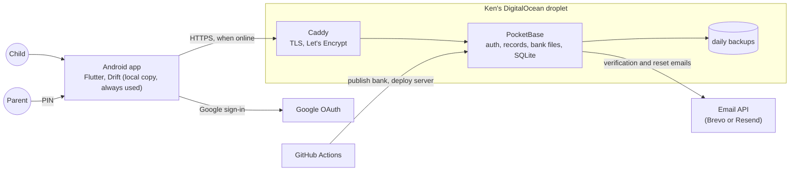

# Number Ninja: Phase 2 architecture

> Version 1.0 draft · 2026-11-15 · Implements [01-requirements.md](01-requirements.md) D10–D16 · Extends [02-design.md](02-design.md) §1 (the app's three layers are unchanged)
> Read by section: `grep -n '^## ' docs/04-architecture.md`. ADR ids are permanent; a reversed ADR keeps its row, marked *Superseded by ADR-NN*.

## 1. Context

The app stays offline-first: screens read and write only the Drift database, as in v1. A sync service in `lib/data/sync/` moves records between Drift and the server in the background. The domain layer stays pure Dart and knows nothing about the server.

## 2. Server

| Part | Choice | Why |
|---|---|---|
| Backend | **PocketBase** (one Go binary, SQLite, built-in email/password and OAuth2 auth, file storage, API rules, admin UI, backups) | Fits one family's load on a small droplet with almost no upkeep; no database server to run; a Dart client (`pocketbase` package) exists. |
| TLS and routing | **Caddy** in front, automatic Let's Encrypt certificate | HTTPS needs a hostname (NFR-12), Caddy renews by itself. |
| Email | A transactional email API (Brevo or Resend, free tiers) over HTTPS port 443 or its alternate SMTP port | DigitalOcean blocks outbound SMTP ports on droplets by default. |
| Process | systemd units for PocketBase and Caddy; files under `/opt/numberninja` | No Docker needed on a small droplet. |
| In the repo | `server/`: `pb_migrations/` (collections and API rules as code), `pb_hooks/` (reset and delete-account hooks), `Caddyfile`, systemd units, `deploy.sh`, `test/` (API rule tests) | NFR-13, NFR-15: the server is rebuilt from the repo, never hand-edited in the admin UI. |

### Collections (PocketBase)

| Collection | Fields | API rule |
|---|---|---|
| `users` (auth) | email, verified, name; Google linked as OAuth2 | own record only |
| `children` | owner → users, nickname, school_year, start_level_school, start_level_olympiad, daily_limit_min, sound_on, field_times (json: last change per field), reset_epoch | `owner = @request.auth.id` |
| `rounds` | child, uuid (unique), topic_id, level, kind (`normal` / `revision`), started_at, finished_at, score, duration_ms, stars, device_id | via `child.owner` |
| `attempts` | child, uuid (unique), round_uuid, question_id, answer_given, correct, time_ms, answered_at | via `child.owner`; create only |
| `badges` | child, badge_id (unique per child), earned_at | via `child.owner` |
| `daily_usage` | child, day, device_id (unique per child + day + device), seconds_used, extra_seconds_granted | via `child.owner` |
| `banks` | version (unique), format, min_app_build, sha256, file, published_at | read: anyone; write: superuser (publish step) only |

Each record also has PocketBase's own `updated` time, which the sync uses as its cursor.

## 3. App changes

| Where | What |
|---|---|
| `lib/domain/` | `ChildProfile`, start-level rule (PRO-03); `RevisionPlanner` interface and `RuleRevisionPlanner` (REV-01..06); merge rules as pure functions (ADR-04), tested without a server. |
| `lib/data/database.dart` | One schema bump per feature that needs it: `child_profile` table (FEAT-10); `kind` on `rounds` (FEAT-11); `uuid` on `rounds` and `attempts` (backfilled), `device_id` and the day + device key on `daily_usage`; `sync_state` (cursor per collection, last sync, last error) (FEAT-14); `bank_files` (downloaded versions, FEAT-15). |
| `lib/data/sync/` | `ServerClient` (wraps the `pocketbase` package), `SyncService` (push then pull, ADR-04), `AuthRepository` (session in `flutter_secure_storage`, ACC-05). |
| `lib/data/question_bank_loader.dart` | Loads the newest valid bank: downloaded if newer and checked, else bundled (BNK-08, BNK-09). |
| `lib/features/` | New screens below; revision entry on SCR-02 and SCR-05. |
| `android/` | `INTERNET` permission in the main manifest; no cleartext (NFR-11, NFR-12); Google sign-in client config. |
| Config | Server base URL passed at build time (`--dart-define=SERVER_URL=…`); CI sets it for release builds, tests use a fake `ServerClient`. |

### New screens (continue 02-design.md §6)

| ID | Screen | Requirements |
|---|---|---|
| SCR-12 | Child profile: nickname, school year, starting level per track | PRO-01, PRO-02 |
| SCR-13 | Account: sign in, create account, forgot password, Google button; when signed in: email, last sync, Sync now, sign out, delete account, privacy note | ACC-01..07, SYN-07, NFR-14 |
| SCR-14 | Revision start: what she will practise (topic or "mixed"), Go button; the round itself uses SCR-04 and SCR-05 | REV-03, REV-04 |

## 4. Decisions (ADRs)

| ID | Decision | Alternatives considered | Consequences |
|---|---|---|---|
| ADR-01 | **PocketBase on Ken's droplet** for auth, data and bank files (D14). | Firebase (free, but Ken prefers his own server); Supabase self-hosted (about 10 containers, too heavy for a small droplet); own Dart `shelf` server + Postgres (most code to write and secure). | Very little server code; one SQLite file to back up. PocketBase is pre-1.0, so the version is pinned in `server/` and upgraded deliberately. |
| ADR-02 | **HTTPS through a hostname with a Let's Encrypt certificate.** Recommended: buy a domain for the new name (about US$10–15 a year) and point `api.<domain>` at the droplet. Free fallback: a DuckDNS subdomain. | Raw IP over HTTP (Android blocks cleartext and Google sign-in needs HTTPS); self-signed certificate (has to be pinned in the app, breaks easily). | The base URL is built into the app, so changing the hostname later needs an app update. A real domain also lets the email service send from it, so reset emails don't land in spam. *Ken chose a bought domain for the new name: `brainbubblz.com`, server at `api.brainbubblz.com` (2026-11-15).* |
| ADR-03 | **Auth by PocketBase**: email and password with verification and reset emails; Google through PocketBase's OAuth2 (Android: Google sign-in gives an id token, or the browser flow PocketBase supports). | Firebase Auth alongside PocketBase (two systems); magic links (deep links fiddly on Android). | Ken creates a Google Cloud OAuth client and an email-service key; both go into PocketBase settings, not the repo. |
| ADR-04 | **Offline-first sync, push then pull, with simple merge rules.** Each record has an id made on the device (uuid). Attempts are only ever added: merged by uuid. A round may be saved again when it finishes: its finish fields only move from empty to set. Badges: one per badge id, earliest `earned_at` wins. Profile and settings: last change wins, per field, by the time the change was made. Screen time: one row per device and day; the day's used time is the sum over devices, so the daily limit holds across devices. Pull asks for records `updated` after the stored cursor. | A sync library or CRDT package (more than this needs); server as the source of truth with the app online-only (breaks offline practice). | No conflicts that need a person. Device clocks only order profile and settings edits, which are rare and made by one parent. Reset (SYN-06) bumps `children.reset_epoch`; a device that sees a higher epoch clears its local progress. |
| ADR-05 | **Bank published from CI.** A `publish_bank` input on the CI workflow runs the generator and validator, checks that no previous id is missing (BNK-10), and uploads `bank_v<N>.json` with its sha256 as a superuser using a repo secret. The app checks `banks` for the highest version it can read, downloads, checks sha256 and runs the loader's checks, then keeps it under app storage. | Ken uploading by hand in the admin UI (no validator, easy to break); the app downloading every launch (wasteful). | Bank JSON gains `format` and `retired` fields; the bundled bank stays in the APK as the fallback. |
| ADR-06 | **Revision planner interface (AI-ready).** `RevisionPlanner.plan(history, bank, scope) → RevisionPlan` in the domain layer; phase 2 ships `RuleRevisionPlanner` (weak types and recent mistakes, rules in FEAT-11's design). A later AI planner can run on the server and return the same plan shape. | Rules inside the quiz controller (hard to swap). | Screens and stats don't change when the planner does. Sending her data to an AI service later needs its own decision and a privacy note update. |
| ADR-07 | **Privacy for a child's data.** The server stores only nickname, school year, practice records and the parent's email. No real name, birth date, photos, location, ads or analytics. Account delete removes everything on the server (ACC-07). Data stays on Ken's droplet; choose a Singapore (SGP1) droplet if a new one is ever made. | — | Satisfies PDPA basics for a family app; a privacy policy page will be needed if the app is ever published on Google Play. |
| ADR-08 | **Deploy and backups.** `server/deploy.sh` copies the binary, migrations, hooks and Caddy config over SSH and restarts the services; run from a CI workflow with the droplet's host and an SSH deploy key as repo secrets (Ken adds them). PocketBase backups run daily at 03:00 SGT, 14 kept; Ken may also turn on DigitalOcean droplet backups for an off-box copy. | Manual edits on the droplet (not reproducible). | NFR-15. The restore drill is a task in FEAT-12. |

## 5. What Ken sets up (before FEAT-12, about 30 minutes, steps in FEAT-12's design)

1. Buy `brainbubblz.com` (D16, ADR-02).
2. Point a DNS A record (`api.brainbubblz.com`) at the droplet's IP.
3. Add repo secrets: droplet host, SSH deploy key, PocketBase superuser email and password.
4. Create a free email-service account (Brevo or Resend) and verify the sending domain.
5. Create a Google Cloud OAuth client for Android (FEAT-13).
