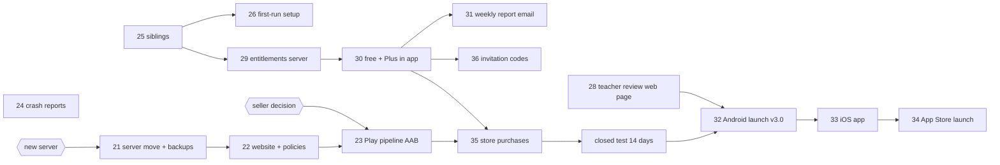

# BrainBubblz: Phase 3 plan

> Version 1.0 · 2026-11-20 · **Signed off by Ken 2026-11-20** ("everything else is ok") with his changes: app features first, server move and seller identity later, accessibility deferred, teacher review on a web page, invitation codes added. The recommendations in §6 are the defaults; each feature's design confirms the decision it needs, and decision 1 (seller identity) stays open until M10.
> Requirement ids and D20+ decisions are added to [01-requirements.md](01-requirements.md) by each feature's design (as FEAT-18..20 did); ADR-09..13 go into [04-architecture.md](04-architecture.md) with the feature that first needs them; feature rows are in [03-plan.md](03-plan.md) §1. Each feature runs design → build → verify as in AGENTS.md.
> Read by section: `grep -n '^## ' docs/05-phase3-plan.md`.

## 1. Goal

Take BrainBubblz (v2.1.0, Android only, one child, everything free) to a public app on Google Play and then the App Store, for any family, with:

1. a friendly first-run setup for parents,
2. siblings (more than one child per family),
3. crash reports,
4. accessibility,
5. a teacher's review of the question bank,
6. a free tier and a yearly subscription (paid: revision, continuous question updates, parent progress reports),
7. iOS,

plus the store blockers from the app-store readiness review (2026-11-20): server on a supported Ubuntu with off-site backups, privacy policy, Data safety and a web deletion page, AAB with Play App Signing, and the 12-tester, 14-day closed test.

Unchanged: offline-first practice (D10), the generator as the only question source (D11), the PIN on the device only, no ads, analytics or tracking SDKs (NFR-14), Ken's own server (D14).

## 2. Milestones at a glance

Changed 2026-11-20 at Ken's request: **app features first**; the new server (available in about a week) and the seller identity (personal developer account or a sole proprietorship, Ken assessing) move to a later store milestone; accessibility is deferred.

| Milestone | What Ken gets | Features | Release |
|---|---|---|---|
| **M8 Family ready** | Siblings, the new parent setup, crash reports | FEAT-25, 26, 24 | `v2.2.0` (APK on GitHub) |
| **M9 Free and Plus** | Server entitlements, free/Plus split in the app with complimentary grants, invitation codes for friends, weekly parent report email | FEAT-29, 30, 36, 31 | `v2.3.0` (APK on GitHub) |
| **Parallel track** | Teacher review web page (`review.brainbubblz.com`), "Report this question"; fixes ship as new bank versions (no app release) | FEAT-28 | bank v3+ |
| **M10 Store-ready** (after the new server and the seller decision) | Server on Ubuntu 24.04 with off-site backups, website with privacy policy, terms and account deletion, Play-ready AAB, real store purchases | FEAT-21, 22, 23, 35 | `v2.4.0`; **closed test starts here** (14 days, if a personal account) |
| **M11 Android launch** | Store listing, Families declarations, production rollout | FEAT-32 | `v3.0.0` on Google Play |
| **M12 iOS** | iPad and iPhone app on TestFlight, then the App Store with the same subscription | FEAT-33, 34 | `v3.1.0` on the App Store |
| **Deferred** | Accessibility (Ken, 2026-11-20); to be scheduled later, before or after launch | FEAT-27 | — |

Same milestone rule as before: at each milestone Ken merges the verified PRs, CI publishes a GitHub release with the APK, and Ken checks it on the tablet before the next milestone starts.

Why this order:

- **Siblings before first-run setup:** the setup asks "who will play?", so it is built once on the multi-child model, not twice.
- **Crash reports early:** they run on the current server and catch problems from the big siblings change on Ken's tablet.
- **Free/Plus before the store:** the gating, the Plus screen and the server entitlement don't need a store account. Complimentary grants make them testable now; FEAT-35 only adds the store connection once the Play account exists.
- **Building on the old droplet is safe:** FEAT-21 restores the latest backup onto the new server, so every migration made before the move comes with it (and the move doubles as the NFR-15 restore drill).
- **Store milestone together:** the website, the Play app, purchases and the closed test all need the seller identity, so they wait for it as one block. A personal account must run the 12-tester, 14-day closed test; a sole proprietorship can register as an organisation (needs a D-U-N-S number) and skip it.
- **Subscription before the public launch:** turning free features into paid ones after launch upsets families.
- **iOS last:** it reuses everything above; the subscription is store-neutral, so iOS only adds StoreKit.
- **Teacher review in parallel:** mostly the teacher's calendar time; fixes ship as server bank versions (FEAT-15). School topics must be signed off before FEAT-32.

## 3. Features

Sizes: **S** = small (≤5 tasks, design and build in one thread), **M** = 6–8 tasks, **L** = needs two build sessions.

### M8 Family ready

| Feature | What it delivers | Size | Ken's hands |
|---|---|---|---|
| **FEAT-25** Siblings | Up to 4 children per family. Schema bump: `child_profile` becomes a children table with uuids; rounds, attempts, badges, daily usage and topic unlocks get a child id, existing data backfilled to the first child. A **"Who's playing?"** picker on launch when there is more than one child (avatar and nickname). Each child has her or his own levels, topic locks, badges, revision, stats and **own daily screen-time limit**. Parent dashboard, day view and PDF report get a child switcher; parent can add, edit and remove a child (PIN). Sync per child: the server's `children` collection already allows several per owner; reset and delete work per child (SYN-06, ACC-07). | L | none |
| **FEAT-26** Parent first-run setup | Replaces today's SCR-01 → SCR-12 with a step-by-step welcome: what the app does (three friendly cards), create the PIN (with why and confirm), add children (nickname, avatar, school year, optional start level), daily time per child with a suggested default, sound on or off, optional **sign in or restore from an account** (if the account already has children, they come back and those steps are skipped), and a last "You're set" page showing how to reach the parent area. Progress dots, Back on every step, big buttons, copy written for parents; resumes at the same step if the app is killed; installs that are already set up never see it. | M | Try it on the tablet; optional: pick from 2–3 illustration styles |
| **FEAT-24** Crash reports | Runs on the current server (moves with it in FEAT-21). Dart errors (`FlutterError.onError`, `PlatformDispatcher.onError`) saved to a local table and sent when online to a create-only `crash_reports` collection on our server: app version, bank version, OS and device model, screen, stack trace. No child data, no device id, rate-limited. Parent switch "Send crash reports" in settings. Native crashes and ANRs come free from **Play Console Android vitals** (and later Xcode Organizer), so no third-party SDK. Ken reads reports in the PocketBase admin, with an optional daily digest email. | S | none |

### M9 Free and Plus

| Feature | What it delivers | Size | Ken's hands |
|---|---|---|---|
| **FEAT-29** Entitlements on the server | An `entitlements` record per parent account: plan, source (Google Play, App Store, or **complimentary**), expiry, status. A webhook endpoint (from the billing service, ADR-09) with a shared secret updates it. API rules: downloading a server bank needs an active entitlement (the bundled bank stays free); child data rules unchanged. Complimentary grants from the admin for Ken's family and testers. Rule tests in `server/test`. | M | Billing service account and webhook secret as repo secrets |
| **FEAT-30** Free tier and BrainBubblz Plus in the app | Everything in the app except the store connection: the Plus screen in the PIN-protected parent area (the parental gate both stores require), which features are free and which are Plus (§4), the child's friendly "Ask a grown-up" lock (never a buy button), the cached entitlement with a 7-day offline grace so offline-first holds, downgrade hides Plus features and deletes nothing. Purchases sit behind a `PurchaseService` interface; until FEAT-35 the only way to get Plus is a complimentary grant from the admin, so Ken's family and testers can use and test it end to end. | M | none |
| **FEAT-36** Invitation codes (Ken, 2026-11-20) | Ken makes codes that let friends (and closed-test testers) unlock Plus without paying. Server: an `invite_codes` collection (code, Plus length such as 3 or 12 months, how many uses, expiry date, a note like "school friends"), only Ken (admin) creates them; a redeem endpoint that needs a signed-in parent, checks the code, counts the use, and writes a complimentary entitlement with its own end date (FEAT-29); wrong guesses are rate-limited. Codes are short and easy to type (no 0/O or 1/I). App: "Have an invitation code?" on the Plus screen; after redeeming it shows "Plus until <date>, from an invitation". A small script or CI workflow makes a batch of codes and prints them. Store rules: Google Play allows free codes like this because no payment is involved; **Apple does not allow an app's own codes to unlock features (guideline 3.1.1)**, so on iOS the code box is hidden and iPhone and iPad friends get **Apple's own subscription offer codes** instead (Ken, 2026-11-20; set up in FEAT-34). | S | Decide code lengths and who gets them; make codes |
| **FEAT-31** Weekly parent report email (Plus) | A weekly server job builds a short email per child from synced data (time practised, rounds, accuracy, weakest topics, new badges) and sends it through Resend; parent turns it on or off. Uses only data already synced; no new data collected. | S | none |

### Parallel track: question quality

| Feature | What it delivers | Size | Ken's hands |
|---|---|---|---|
| **FEAT-28** Teacher review of the questions (web page) | The teacher reviews the **question bank** (not a child's answers) on a web page, so no app or tablet is needed (Ken, 2026-11-20). A small **Flutter web** build at `review.brainbubblz.com`, served by the same nginx, reuses the app's question and visual widgets so questions look exactly as the child sees them. Reviewer accounts (a `reviewer` role in PocketBase, created by Ken) sign in and go topic by topic: for each generator template (question type) a sample of questions with the answer and question id, every Olympiad template in full. Per question type: OK, wrong answer, unclear wording, wrong level, off-syllabus, plus a comment; progress per topic and "topic signed off". Verdicts are saved to a `question_reviews` collection (reviewers write only their own; nobody else reads them except Ken). `tool/apply_review.dart` exports them into a findings list; fixes go into the generator templates, bad ids are retired (BNK-10), and the publish workflow ships a new bank version. Also a parent-only **"Report this question"** button on the answer list in topic detail and day view, sent to a `question_reports` collection that shows up on the same review page. Starts on the current droplet with its own nginx site and moves with the server in FEAT-21; no need to wait for FEAT-22. | M | Find a teacher (MOE-trained P1/P2; ideally an Olympiad coach for those topics), agree a fee and dates, create their reviewer account |

### M10 Store-ready (after the new server and the seller decision)

| Feature | What it delivers | Size | Ken's hands |
|---|---|---|---|
| **FEAT-21** Server move and off-site backups | New droplet on Ubuntu 24.04 LTS (SGP1, ADR-07), only BrainBubblz on it (away from the denoiser restart loop that filled `/run`). `install.sh` on the fresh host, restore the latest backup onto it (the NFR-15 restore drill), check, then switch the `api` DNS record. Nightly copy of the PocketBase backups to off-box object storage, 30 days kept, plus a scripted monthly restore check. A scheduled CI health check that opens an issue if `/api/health` fails. | S | Create the droplet, an object-storage bucket and key, change one DNS record; ~30 min |
| **FEAT-22** Website and store policies | Small static site on `brainbubblz.com` served by the same nginx: home, **privacy policy** (from ADR-07 and NFR-14, plus crash reports and purchases), **terms of use** (needed for subscriptions), **delete my account** page (sign in, confirm, same server hook as ACC-07, for Play's web deletion rule), support contact. In-app privacy note links to it. Drafted answers for Play's **Data safety** form and content rating questionnaire in `docs/store/`. | S | A support/privacy email address (forwarding on the domain), read and approve the policy text |
| **FEAT-23** Play release pipeline | CI builds a signed **AAB** next to the APK; version code from the build number; target API checked against Play's current minimum. **Play App Signing using our existing release key** (uploaded as the app signing key), so the GitHub APK and the Play build stay update-compatible and Ken's tablet never has to reinstall. Optional CI upload to the internal testing track with a service account. Store listing text and screenshots generated by a test at the sizes Play wants. | M | Play Console account, create app `com.brainbubblz.kids`, enrol Play App Signing with our key, a service account for uploads |
| **FEAT-35** Store purchases | Connects FEAT-30's `PurchaseService` to Google Play Billing through the billing service (ADR-09): yearly subscription with a free trial, buy, restore, manage (link to the store's subscription page); buying needs a parent account (created in the flow) so Plus covers every device and both stores; the store webhook updates FEAT-29's entitlement; license testers for the closed test. Needs the Play Console app, so it waits for the seller decision. | M | Create the subscription product, price and trial in Play Console; payments profile, tax and bank details |

### M11 Android launch

| Feature | What it delivers | Size | Ken's hands |
|---|---|---|---|
| **FEAT-32** Google Play launch (`v3.0.0`) | Store listing (short and long description, icon, feature graphic, screenshots), content rating, **target audience and Families policy** declarations (ages 6–8 and parents), Data safety from FEAT-22's draft, closed-test feedback fixed, production access request, staged rollout. Mostly checklists and drafts from us; Ken clicks submit. | S | Submit forms, answer Google's production-access questions, approve the listing |

### M12 iOS

| Feature | What it delivers | Size | Ken's hands |
|---|---|---|---|
| **FEAT-33** iOS app | `ios/` platform added, bundle id `com.brainbubblz.kids`; Google sign-in return and `brainbubblz://signin` on iOS; **Sign in with Apple** (PocketBase supports it; see decision 9); Keychain for the session; PDF share, sound, and layouts checked at iPad and iPhone sizes; CI builds on a macOS runner with App Store Connect API-key signing and uploads to **TestFlight**. | L | Apple Developer enrolment, App Store Connect app record, API key, an iPad or iPhone to test on |
| **FEAT-34** App Store launch (`v3.1.0`) | StoreKit through the same billing service, so FEAT-29's entitlement covers both stores; **Apple subscription offer codes** for friends on iOS (Ken, 2026-11-20), redeemed through the App Store's own sheet, in place of FEAT-36's codes; **Kids Category** (ages 6–8) rules: no third-party analytics, parental gate before purchases and links out; App Privacy labels; screenshots; App Review submission. | M | Paid Apps agreement, tax and banking, submit for review |

### Deferred

| Feature | What it delivers | Size | Ken's hands |
|---|---|---|---|
| **FEAT-27** Accessibility | Screen-reader labels (TalkBack now, VoiceOver later) on every control, and a spoken description for each drawn visual (from the question data); right/wrong announced and never shown by colour alone; text scaling up to 1.5× (theme and layout checks extended) without overlap; colour contrast of `theme.dart` checked to WCAG AA; celebrations follow the system "remove animations" setting; a **tap-to-place** alternative to drag and drop; a parent option for relaxed timing if any timer pressure shows. Widget tests use Flutter's accessibility guideline matchers; a short manual TalkBack checklist for Ken. | M | 10-minute TalkBack check on the tablet |

Rough calendar: M8 and M9 are build time (a few days each at the pace of phase 2) and can run while Ken waits for the server and decides on the seller identity. After that, the slow parts are outside our control: a D-U-N-S number if Ken registers a business and uses an organisation account (days to weeks), the 14-day closed test plus Google's production-access review (up to about a week) on a personal account, the teacher's review, and Apple's first review (usually 1–3 days, longer for Kids Category). A realistic Android production date is about 3–4 weeks after M10 starts; iOS 2–3 weeks after that.

## 4. Free and Plus (proposal)

| | Free | Plus (yearly) |
|---|---|---|
| All School and Olympiad topics, three answer formats, levels, topic unlocking | ✓ | ✓ |
| Badges, sounds, screen-time limit, PIN | ✓ | ✓ |
| Parent dashboard (accuracy and speed per topic) | ✓ | ✓ |
| Account and sync across devices | ✓ (keeps progress safe; needed to buy) | ✓ |
| Children | 1 | up to 4 |
| Revision module (REV) | — | ✓ |
| Question updates from the server (BNK-07..12) | bundled bank, updated with app releases | new questions as soon as they are published |
| Progress reports: PDF export, per-day view, trends, weekly email | — | ✓ |

Existing behaviour that moves behind Plus (revision, PDF, day view, server bank) stays on for Ken's family through a complimentary grant. Price is Ken's call; a 14-day free trial is the common pattern for kids' learning apps. Stores take 15 % of subscription revenue; both collect Singapore GST themselves.

## 5. Architecture changes (proposed ADRs)

| ID | Proposal | Alternatives | Consequences |
|---|---|---|---|
| ADR-09 | **Billing through RevenueCat** (`purchases_flutter`) for Google Play Billing and StoreKit; its webhook updates our entitlement record. Free until US$2.5k monthly tracked revenue, then 1 % (check current pricing). | Flutter's `in_app_purchase` plus our own receipt checks: Google Play Developer API with a service account, Pub/Sub real-time notifications, App Store Server API and signed notifications, all in PocketBase hooks. No fee, but the most security-sensitive code we would write and test ourselves. | One SDK for both stores, sandbox handling and renewals done for us. It sees the parent account id and purchases (no child data): listed in the privacy policy and Data safety. Switching away later keeps our entitlement record, so the app doesn't change. |
| ADR-10 | **Entitlement is checked by our server, cached by the app.** The server gates what costs us (bank downloads); the app gates on-device features from the cached entitlement with a 7-day offline grace. | App-only checks (easy to bypass, and the server bank would be open); server checks for everything (breaks offline practice). | A patched APK could unlock on-device Plus features; acceptable for a family app, and the ongoing-cost item stays protected. |
| ADR-11 | **Crash reports on our own server** plus the stores' built-in vitals. | Firebase Crashlytics or Sentry (richer, but third-party SDKs that send device data from a children's app; harder under Families and Kids Category rules and NFR-14). | Dart errors only from our reporter; native crashes from Play vitals and Xcode Organizer. |
| ADR-12 | **Multi-child local schema.** Child id on every progress table, active child held in app state, every repository query scoped by child. | A separate database per child (simpler queries, but sync, reports and migrations multiply). | One schema bump with a backfill migration and tests; ADR-04 merge rules apply per child unchanged. |
| ADR-13 | **iOS builds in CI on macOS runners**, signed with an App Store Connect API key, uploaded to TestFlight. | Building on a Mac by hand (Ken has to own one and do it each release); Codemagic (free 500 macOS minutes a month, a second CI to maintain). | No Mac needed. On a private repo, macOS minutes count 10× against GitHub's free minutes; a release build every few days fits. |

## 6. Open decisions for Ken (each with a recommendation)

1. **Seller identity.** Personal developer accounts must run the 12-tester, 14-day closed test and show the developer's name publicly; organisation accounts skip the test but need a registered business and a free D-U-N-S number (one number serves Google and Apple). Ken is assessing a personal account against registering a sole proprietorship online (2026-11-20); it is needed only from M10. *Recommend:* a personal account is fastest and fine to start with; a sole proprietorship (then an organisation account with a D-U-N-S number) skips the closed test and keeps Ken's own name off the listing, but allow a few weeks for the D-U-N-S number.
2. **Free/Plus split** as in §4. *Recommend* as shown; the main question is whether siblings are Plus-only (recommended) and whether sync stays free (recommended: yes).
3. **Price and trial.** *Recommend:* yearly only, 14-day trial, price set after looking at 3–4 comparable apps on the Singapore store.
4. **Billing: RevenueCat or our own** (ADR-09). *Recommend:* RevenueCat.
5. **Siblings rules.** *Recommend:* up to 4 children; own screen-time limit per child; switching child needs no PIN (a parent option can require it).
6. **Crash reports default.** *Recommend:* on by default with the switch and a line in the privacy note (no personal data is in them).
7. **Accessibility and read-aloud.** FEAT-27 deferred by Ken (2026-11-20). Read-aloud reverses D6 (no voice); it comes back with K2 (decision 12).
8. **Teacher review.** Who and how many hours; the format is decided: a web page (Ken, 2026-11-20). *Recommend:* one P1/P2 teacher for School topics first (about one question type per minute of review), Olympiad after.
9. **Sign in with Apple on iOS.** Apple's rule 4.8 asks for it when Google sign-in is offered. *Recommend:* add it on iOS (and allow it on Android later).
10. **iPhone or iPad only.** *Recommend:* both; the phone layouts from FEAT-19 already exist.
11. **Closed-test testers.** 12 people with Android devices who stay opted in for 14 days in a row. *Recommend:* line them up now (friends, family, school parents) so the test starts the day M10 is released (personal account only).
12. **Wider age range** (K2, P3, P4–P6): see §8. *Recommend:* P3 next, then P4; P5–P6 and K2 later.
13. **Invitation codes.** *Recommend:* each code gives 12 months of Plus, up to 5 uses per code unless Ken sets otherwise; the code redeems once per account; when it ends the family drops to free (nothing deleted) unless they subscribe.

## 7. What needs Ken's hands, and costs

| When | Task | Cost |
|---|---|---|
| Now | Decide 2–12 above; find a teacher | teacher's fee |
| Before M10 | Seller identity (decision 1); new droplet ready; line up 12 testers if a personal account | see below |
| FEAT-21 | New droplet (Ubuntu 24.04, SGP1), object-storage bucket and key, DNS change | droplet ~US$6–12/month (overlap with the old one for a few days); storage ~US$5/month or less |
| FEAT-22 | Support/privacy email address on the domain; approve the policy text | free (email forwarding) |
| FEAT-23 | Google Play Console account (if none), identity checks, create the app, Play App Signing, service account | **US$25 once** |
| FEAT-35 | RevenueCat account (if decision 4), subscription product, payments profile, tax and bank | 15 % of subscription revenue to Google; RevenueCat free at first |
| FEAT-32 | Store forms (content rating, target audience, Data safety), production access request, rollout | — |
| FEAT-33/34 | **Apple Developer Program**, App Store Connect app, API key, agreements, tax and banking, a test iPad or iPhone | **US$99 a year**; 15 % of revenue (Small Business Program) |
| Optional | Business registration and D-U-N-S (decision 1) | ACRA registration fee; D-U-N-S free |

Still open from phase 2 and folded in here: the FEAT-12 restore drill (FEAT-21) and the FEAT-14 two-tablet sync check (AC-9), which Ken can do at any time and which FEAT-25 will re-test per child.

## 8. Wider age range: K2, P3, P4–P6 (assessment, Ken asked 2026-11-20)

Today the bank covers P1 revision, P2 and Olympiad (D2, D3). Wider ages make a yearly subscription worth more, since a family keeps paying as the child moves up. The question is whether each level still works as "read the question, answer on the screen".

| Level | What changes | Works on screen? | Verdict |
|---|---|---|---|
| **P3** | Numbers to 10,000, all four operations, 6–9 times tables, simple fractions, money, length, mass, volume, time, angles, area and perimeter, bar graphs | Yes. Answers are whole numbers or a choice; word problems are longer but readable on a tablet. Needs a fraction answer pad and units shown next to the box. | **Do next.** Your daughter reaches P3 in 2028; it uses the formats and the topic lock we have. About one bank feature plus a small answer-pad feature. |
| **P4** | Decimals, fraction of a set, factors and multiples, symmetry, nets, longer multi-step word problems | Mostly. Final answers still fit a number, decimal or fraction pad, or a choice. Multi-step problems need somewhere to work. | **Do after P3**, with an in-app **scratchpad** (draw with a finger over the question, kept with the round) so working out doesn't need paper. |
| **P5–P6** | Ratio, percentage, speed, algebra, volume, pie charts, PSLE-style heuristic problems | Partly. PSLE Paper 2 marks the working, which a screen can't check; geometry needs accurate diagrams; multi-step templates are the hardest to generate well. | **Later, as "practice by answer only"**: short-answer and choice questions (PSLE Paper 1 style) plus the scratchpad. Don't promise full PSLE preparation. Needs the teacher review process proven first. |
| **K2** | Counting, numbers to 20, shapes, patterns, comparing, simple adding with pictures | Only with sound. Most 5–6 year-olds can't read the questions on their own. | **Later, and only with read-aloud** (reverses D6 "no voice"): offline text-to-speech or recorded audio, picture-only answers, bigger targets. Good demand from parents preparing for P1, but the most new work per question. |

Cross-cutting changes for any of these: school year values in the profile (K2 = year 0, P3–P6) and the topic lock (PRC-12..14) extend as they are; screen-time defaults by age (20 minutes suits P1–P2, older children may need 30–45); each level gets its own teacher review (FEAT-28) before release. Suggested feature ids if Ken agrees: P3 bank and fraction pad first, scratchpad with P4, K2 read-aloud as its own decision.
