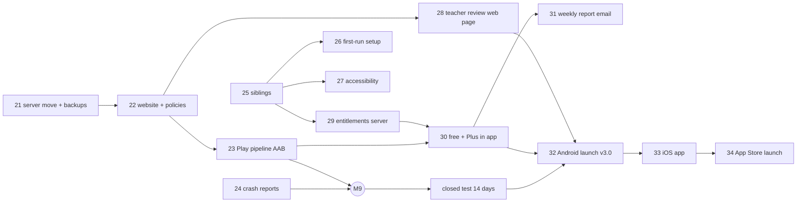

# BrainBubblz: Phase 3 plan (proposal)

> Version 0.1 · 2026-11-20 · **Proposal for Ken's review, not signed off.** Nothing here is built yet.
> On sign-off: the decisions become D20+ and the requirement rows (ids below are placeholders by group) go into [01-requirements.md](01-requirements.md) 3.0, the ADRs into [04-architecture.md](04-architecture.md), the feature rows into [03-plan.md](03-plan.md) §1. Each feature then runs design → build → verify as in AGENTS.md.
> Read by section: `grep -n '^## ' docs/05-phase3-plan.md`.

## 1. Goal

Take BrainBubblz (v2.1.0, Android only, one child, everything free) to a public app on Google Play and then the App Store, for any family, with:

1. a friendly first-run setup for parents,
2. siblings (more than one child per family),
3. crash reports,
4. accessibility,
5. a teacher's review of the question bank,
6. a free tier and a yearly subscription (paid: revision, continuous question updates, parent progress reports),
7. iOS,

plus the store blockers from the app-store readiness review (2026-11-20): server on a supported Ubuntu with off-site backups, privacy policy, Data safety and a web deletion page, AAB with Play App Signing, and the 12-tester, 14-day closed test.

Unchanged: offline-first practice (D10), the generator as the only question source (D11), the PIN on the device only, no ads, analytics or tracking SDKs (NFR-14), Ken's own server (D14).

## 2. Milestones at a glance

| Milestone | What Ken gets | Features | Release |
|---|---|---|---|
| **M8 Store-ready base** | Server on a supported OS with off-site backups, a website with privacy policy, terms and account deletion, a Play-ready AAB, crash reports | FEAT-21, 22, 23, 24 | `v2.2.0` (APK on GitHub + first AAB on Play internal testing) |
| **Parallel track** | Teacher review web page (`review.brainbubblz.com`), verdicts saved on the server, "Report this question"; fixes ship as new bank versions (no app release) | FEAT-28 | bank v3+ |
| **M9 Family ready** | Siblings, the new parent setup, accessibility | FEAT-25, 26, 27 | `v2.3.0`; **closed test starts here** (14 days) |
| **M10 Free and Plus** | Server entitlements, free tier and yearly subscription, weekly parent report email | FEAT-29, 30, 31 | `v2.4.0` to the closed test |
| **M11 Android launch** | Store listing, Families declarations, production rollout | FEAT-32 | `v3.0.0` on Google Play |
| **M12 iOS** | iPad and iPhone app on TestFlight, then the App Store with the same subscription | FEAT-33, 34 | `v3.1.0` on the App Store |

Same milestone rule as before: at each milestone Ken merges the verified PRs, CI publishes a GitHub release with the APK, and Ken checks it on the tablet before the next milestone starts.

Why this order:

- **Server first (FEAT-21):** the droplet's Ubuntu 24.10 is end of life and the paid features will run on it. Moving now, while only Ken's family uses it, is the cheapest time. The move doubles as the restore drill still pending from FEAT-12 (NFR-15).
- **Website before the Play pipeline:** Play Console asks for the privacy policy URL and the deletion URL when the app is created.
- **Crash reports before testers:** the closed test is where the first strangers use the app; their crashes should reach us.
- **Siblings before first-run setup:** the setup asks "who will play?", so it should be built once on the multi-child model, not twice.
- **Closed test at M9, not at launch:** the 14 days are calendar time. Starting it once the app is family-ready lets M10 be built while the clock runs; testers get M10 builds as they land and so also test the purchase flow with test cards.
- **Subscription before the public launch:** turning features that were free into paid ones after launch upsets families. Launching with the free/Plus split from day one avoids that.
- **iOS last:** it reuses everything above (setup, siblings, entitlements). The subscription is built store-neutral in M10 so iOS only adds StoreKit.
- **Teacher review in parallel:** it is mostly the teacher's calendar time; fixes ship as server bank versions (FEAT-15), so they never wait for an app release. It must be done for School topics before FEAT-32.

## 3. Features

Sizes: **S** = small (≤5 tasks, design and build in one thread), **M** = 6–8 tasks, **L** = needs two build sessions.

### M8 Store-ready base

| Feature | What it delivers | Size | Ken's hands |
|---|---|---|---|
| **FEAT-21** Server move and off-site backups | New droplet on Ubuntu 24.04 LTS (SGP1, ADR-07), only BrainBubblz on it (away from the denoiser restart loop that filled `/run`). `install.sh` on the fresh host, restore the latest backup onto it (the NFR-15 restore drill), check, then switch the `api` DNS record. Nightly copy of the PocketBase backups to off-box object storage, 30 days kept, plus a scripted monthly restore check. A scheduled CI health check that opens an issue if `/api/health` fails. | S | Create the droplet, an object-storage bucket and key, change one DNS record; ~30 min |
| **FEAT-22** Website and store policies | Small static site on `brainbubblz.com` served by the same nginx: home, **privacy policy** (from ADR-07 and NFR-14, plus crash reports and purchases), **terms of use** (needed for subscriptions), **delete my account** page (sign in, confirm, same server hook as ACC-07, for Play's web deletion rule), support contact. In-app privacy note links to it. Drafted answers for Play's **Data safety** form and content rating questionnaire in `docs/store/`. | S | A support/privacy email address (forwarding on the domain), read and approve the policy text |
| **FEAT-23** Play release pipeline | CI builds a signed **AAB** next to the APK; version code from the build number; target API checked against Play's current minimum. **Play App Signing using our existing release key** (uploaded as the app signing key), so the GitHub APK and the Play build stay update-compatible and Ken's tablet never has to reinstall. Optional CI upload to the internal testing track with a service account. Store listing text and screenshots generated by a test at the sizes Play wants. | M | Play Console account, create app `com.brainbubblz.kids`, enrol Play App Signing with our key, a service account for uploads |
| **FEAT-24** Crash reports | Dart errors (`FlutterError.onError`, `PlatformDispatcher.onError`) saved to a local table and sent when online to a create-only `crash_reports` collection on our server: app version, bank version, OS and device model, screen, stack trace. No child data, no device id, rate-limited. Parent switch "Send crash reports" in settings. Native crashes and ANRs come free from **Play Console Android vitals** (and later Xcode Organizer), so no third-party SDK. Ken reads reports in the PocketBase admin, with an optional daily digest email. | S | none |

### Parallel track: question quality

| Feature | What it delivers | Size | Ken's hands |
|---|---|---|---|
| **FEAT-28** Teacher review of the questions (web page) | The teacher reviews the **question bank** (not a child's answers) on a web page, so no app or tablet is needed (Ken, 2026-11-20). A small **Flutter web** build at `review.brainbubblz.com`, served by the same nginx, reuses the app's question and visual widgets so questions look exactly as the child sees them. Reviewer accounts (a `reviewer` role in PocketBase, created by Ken) sign in and go topic by topic: for each generator template (question type) a sample of questions with the answer and question id, every Olympiad template in full. Per question type: OK, wrong answer, unclear wording, wrong level, off-syllabus, plus a comment; progress per topic and "topic signed off". Verdicts are saved to a `question_reviews` collection (reviewers write only their own; nobody else reads them except Ken). `tool/apply_review.dart` exports them into a findings list; fixes go into the generator templates, bad ids are retired (BNK-10), and the publish workflow ships a new bank version. Also a parent-only **"Report this question"** button on the answer list in topic detail and day view, sent to a `question_reports` collection that shows up on the same review page. Built after FEAT-22 (website and nginx site). | M | Find a teacher (MOE-trained P1/P2; ideally an Olympiad coach for those topics), agree a fee and dates, create their reviewer account |

### M9 Family ready

| Feature | What it delivers | Size | Ken's hands |
|---|---|---|---|
| **FEAT-25** Siblings | Up to 4 children per family. Schema bump: `child_profile` becomes a children table with uuids; rounds, attempts, badges, daily usage and topic unlocks get a child id, existing data backfilled to the first child. A **"Who's playing?"** picker on launch when there is more than one child (avatar and nickname). Each child has her or his own levels, topic locks, badges, revision, stats and **own daily screen-time limit**. Parent dashboard, day view and PDF report get a child switcher; parent can add, edit and remove a child (PIN). Sync per child: the server's `children` collection already allows several per owner; reset and delete work per child (SYN-06, ACC-07). | L | none |
| **FEAT-26** Parent first-run setup | Replaces today's SCR-01 → SCR-12 with a step-by-step welcome: what the app does (three friendly cards), create the PIN (with why and confirm), add children (nickname, avatar, school year, optional start level), daily time per child with a suggested default, sound on or off, optional **sign in or restore from an account** (if the account already has children, they come back and those steps are skipped), and a last "You're set" page showing how to reach the parent area. Progress dots, Back on every step, big buttons, copy written for parents; resumes at the same step if the app is killed; installs that are already set up never see it. | M | Try it on the tablet; optional: pick from 2–3 illustration styles |
| **FEAT-27** Accessibility | Screen-reader labels (TalkBack now, VoiceOver later) on every control, and a spoken description for each drawn visual (from the question data); right/wrong announced and never shown by colour alone; text scaling up to 1.5× (theme and layout checks extended) without overlap; colour contrast of `theme.dart` checked to WCAG AA; celebrations follow the system "remove animations" setting; a **tap-to-place** alternative to drag and drop; a parent option for relaxed timing if any timer pressure shows. Widget tests use Flutter's accessibility guideline matchers; a short manual TalkBack checklist for Ken. | M | 10-minute TalkBack check on the tablet |

### M10 Free and Plus

| Feature | What it delivers | Size | Ken's hands |
|---|---|---|---|
| **FEAT-29** Entitlements on the server | An `entitlements` record per parent account: plan, source (Google Play, App Store, or **complimentary**), expiry, status. A webhook endpoint (from the billing service, ADR-09) with a shared secret updates it. API rules: downloading a server bank needs an active entitlement (the bundled bank stays free); child data rules unchanged. Complimentary grants from the admin for Ken's family and testers. Rule tests in `server/test`. | M | Billing service account and webhook secret as repo secrets |
| **FEAT-30** Free tier and BrainBubblz Plus | Yearly subscription with a free trial, bought only inside the PIN-protected parent area (this is the parental gate both stores require). Buy, restore, manage (link to the store's subscription page). Buying needs a parent account (created in the flow), so Plus covers every device and both stores. Gated features show the child a friendly "Ask a grown-up" lock, never a buy button. The app caches the entitlement and keeps Plus working offline for a grace period (7 days past expiry) so offline-first holds. Downgrade hides Plus features and deletes nothing. License testers for the closed test. | M | Create the subscription product, price and trial in Play Console; payments profile, tax and bank details |
| **FEAT-31** Weekly parent report email (Plus) | A weekly server job builds a short email per child from synced data (time practised, rounds, accuracy, weakest topics, new badges) and sends it through Resend; parent turns it on or off. Uses only data already synced; no new data collected. | S | none |

### M11 Android launch

| Feature | What it delivers | Size | Ken's hands |
|---|---|---|---|
| **FEAT-32** Google Play launch (`v3.0.0`) | Store listing (short and long description, icon, feature graphic, screenshots), content rating, **target audience and Families policy** declarations (ages 6–8 and parents), Data safety from FEAT-22's draft, closed-test feedback fixed, production access request, staged rollout. Mostly checklists and drafts from us; Ken clicks submit. | S | Submit forms, answer Google's production-access questions, approve the listing |

### M12 iOS

| Feature | What it delivers | Size | Ken's hands |
|---|---|---|---|
| **FEAT-33** iOS app | `ios/` platform added, bundle id `com.brainbubblz.kids`; Google sign-in return and `brainbubblz://signin` on iOS; **Sign in with Apple** (PocketBase supports it; see decision 9); Keychain for the session; PDF share, sound, and layouts checked at iPad and iPhone sizes; CI builds on a macOS runner with App Store Connect API-key signing and uploads to **TestFlight**. | L | Apple Developer enrolment, App Store Connect app record, API key, an iPad or iPhone to test on |
| **FEAT-34** App Store launch (`v3.1.0`) | StoreKit through the same billing service, so FEAT-29's entitlement covers both stores; **Kids Category** (ages 6–8) rules: no third-party analytics, parental gate before purchases and links out; App Privacy labels; screenshots; App Review submission. | M | Paid Apps agreement, tax and banking, submit for review |

Rough calendar: M8 and M9 are mostly build time (a few days each at the pace of phase 2). The slow parts are calendar time outside our control: a D-U-N-S number if Ken goes the organisation route (days to weeks), the 14-day closed test plus Google's production-access review (up to about a week), the teacher's review, and Apple's first review (usually 1–3 days, longer for Kids Category). A realistic Android production date is about 4–6 weeks after Ken signs this off; iOS 2–3 weeks after that.

## 4. Free and Plus (proposal)

| | Free | Plus (yearly) |
|---|---|---|
| All School and Olympiad topics, three answer formats, levels, topic unlocking | ✓ | ✓ |
| Badges, sounds, screen-time limit, PIN | ✓ | ✓ |
| Parent dashboard (accuracy and speed per topic) | ✓ | ✓ |
| Account and sync across devices | ✓ (keeps progress safe; needed to buy) | ✓ |
| Children | 1 | up to 4 |
| Revision module (REV) | — | ✓ |
| Question updates from the server (BNK-07..12) | bundled bank, updated with app releases | new questions as soon as they are published |
| Progress reports: PDF export, per-day view, trends, weekly email | — | ✓ |

Existing behaviour that moves behind Plus (revision, PDF, day view, server bank) stays on for Ken's family through a complimentary grant. Price is Ken's call; a 14-day free trial is the common pattern for kids' learning apps. Stores take 15 % of subscription revenue; both collect Singapore GST themselves.

## 5. Architecture changes (proposed ADRs)

| ID | Proposal | Alternatives | Consequences |
|---|---|---|---|
| ADR-09 | **Billing through RevenueCat** (`purchases_flutter`) for Google Play Billing and StoreKit; its webhook updates our entitlement record. Free until US$2.5k monthly tracked revenue, then 1 % (check current pricing). | Flutter's `in_app_purchase` plus our own receipt checks: Google Play Developer API with a service account, Pub/Sub real-time notifications, App Store Server API and signed notifications, all in PocketBase hooks. No fee, but the most security-sensitive code we would write and test ourselves. | One SDK for both stores, sandbox handling and renewals done for us. It sees the parent account id and purchases (no child data): listed in the privacy policy and Data safety. Switching away later keeps our entitlement record, so the app doesn't change. |
| ADR-10 | **Entitlement is checked by our server, cached by the app.** The server gates what costs us (bank downloads); the app gates on-device features from the cached entitlement with a 7-day offline grace. | App-only checks (easy to bypass, and the server bank would be open); server checks for everything (breaks offline practice). | A patched APK could unlock on-device Plus features; acceptable for a family app, and the ongoing-cost item stays protected. |
| ADR-11 | **Crash reports on our own server** plus the stores' built-in vitals. | Firebase Crashlytics or Sentry (richer, but third-party SDKs that send device data from a children's app; harder under Families and Kids Category rules and NFR-14). | Dart errors only from our reporter; native crashes from Play vitals and Xcode Organizer. |
| ADR-12 | **Multi-child local schema.** Child id on every progress table, active child held in app state, every repository query scoped by child. | A separate database per child (simpler queries, but sync, reports and migrations multiply). | One schema bump with a backfill migration and tests; ADR-04 merge rules apply per child unchanged. |
| ADR-13 | **iOS builds in CI on macOS runners**, signed with an App Store Connect API key, uploaded to TestFlight. | Building on a Mac by hand (Ken has to own one and do it each release); Codemagic (free 500 macOS minutes a month, a second CI to maintain). | No Mac needed. On a private repo, macOS minutes count 10× against GitHub's free minutes; a release build every few days fits. |

## 6. Open decisions for Ken (each with a recommendation)

1. **Seller identity.** Personal developer accounts must run the 12-tester, 14-day closed test and show the developer's name publicly; organisation accounts skip the test but need a registered business and a free D-U-N-S number (one number serves Google and Apple). *Recommend:* if Ken already has a personal Play account, keep it and run the closed test; if not, decide now, because a business plus D-U-N-S takes the longest of anything here.
2. **Free/Plus split** as in §4. *Recommend* as shown; the main question is whether siblings are Plus-only (recommended) and whether sync stays free (recommended: yes).
3. **Price and trial.** *Recommend:* yearly only, 14-day trial, price set after looking at 3–4 comparable apps on the Singapore store.
4. **Billing: RevenueCat or our own** (ADR-09). *Recommend:* RevenueCat.
5. **Siblings rules.** *Recommend:* up to 4 children; own screen-time limit per child; switching child needs no PIN (a parent option can require it).
6. **Crash reports default.** *Recommend:* on by default with the switch and a line in the privacy note (no personal data is in them).
7. **Accessibility and read-aloud.** D6 says no voice. Read-aloud of questions would help early readers and blind children but reverses D6. *Recommend:* not in phase 3; do everything else in FEAT-27 and revisit.
8. **Teacher review.** Who and how many hours; the format is decided: a web page (Ken, 2026-11-20). *Recommend:* one P1/P2 teacher for School topics first (about one question type per minute of review), Olympiad after.
9. **Sign in with Apple on iOS.** Apple's rule 4.8 asks for it when Google sign-in is offered. *Recommend:* add it on iOS (and allow it on Android later).
10. **iPhone or iPad only.** *Recommend:* both; the phone layouts from FEAT-19 already exist.
11. **Closed-test testers.** 12 people with Android devices who stay opted in for 14 days in a row. *Recommend:* line them up now (friends, family, school parents) so the test starts the day M9 is released.

## 7. What needs Ken's hands, and costs

| When | Task | Cost |
|---|---|---|
| Now | Decide 1–11 above; line up 12 testers and a teacher | teacher's fee |
| FEAT-21 | New droplet (Ubuntu 24.04, SGP1), object-storage bucket and key, DNS change | droplet ~US$6–12/month (overlap with the old one for a few days); storage ~US$5/month or less |
| FEAT-22 | Support/privacy email address on the domain; approve the policy text | free (email forwarding) |
| FEAT-23 | Google Play Console account (if none), identity checks, create the app, Play App Signing, service account | **US$25 once** |
| FEAT-29/30 | RevenueCat account (if decision 4), subscription product, payments profile, tax and bank | 15 % of subscription revenue to Google; RevenueCat free at first |
| FEAT-32 | Store forms (content rating, target audience, Data safety), production access request, rollout | — |
| FEAT-33/34 | **Apple Developer Program**, App Store Connect app, API key, agreements, tax and banking, a test iPad or iPhone | **US$99 a year**; 15 % of revenue (Small Business Program) |
| Optional | Business registration and D-U-N-S (decision 1) | ACRA registration fee; D-U-N-S free |

Still open from phase 2 and folded in here: the FEAT-12 restore drill (FEAT-21) and the FEAT-14 two-tablet sync check (AC-9), which Ken can do at any time and which FEAT-25 will re-test per child.
